# Dawn of Legends — O Alvorecer das Lendas

**Dawn of Legends** é um jogo web de fantasia em que o jogador assume o papel de um tutor fictício, chamado Guardião. Ele pode cadastrar, pesquisar e adotar criaturas mágicas, cuidar das suas Lendas e montar uma equipe para enfrentar batalhas e torneios.

Projeto acadêmico concluído para a disciplina de **Tecnologia em Desenvolvimento para Internet II**, do **Bacharelado em Sistemas de Informação** do **IFSULDEMINAS – Campus Machado**.

## Como executar

1. Baixe e extraia todos os arquivos do projeto.
2. Abra `index.html` em um navegador atualizado. O jogo funciona offline, sem instalação ou servidor local.
3. Clique em **Nova jornada**, informe o nome fictício do tutor e escolha sua primeira Lenda.
4. No Observatório, abra **Adoção** para cadastrar, pesquisar e adotar Lendas. Abra **Santuário** para consultar e atualizar os estados das Lendas adotadas.

## Guia das telas

- [Tela inicial](#tela-inicial) · [Primeiro vínculo](#primeiro-vínculo) · [Observatório](#observatório)
- [Centro de Adoção](#centro-de-adoção) · [Santuário](#santuário) · [Coleção](#coleção)
- [Arena](#arena) · [Torneios](#torneios) · [Missões](#missões) · [Perfil](#perfil) · [Acessibilidade](#acessibilidade)

### Tela inicial

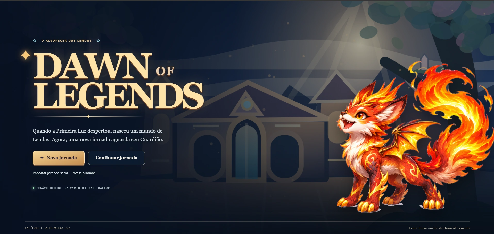

- **Nova jornada** abre a escolha da primeira Lenda. Com uma jornada existente, o jogo pede confirmação e só a substitui quando o jogador confirma a nova Lenda.
- **Continuar jornada** aparece quando existe um salvamento válido no navegador e leva ao Observatório.
- **Importar jornada salva** lê um backup em JSON. **Acessibilidade** abre as configurações antes mesmo de criar uma jornada.

### Primeiro vínculo

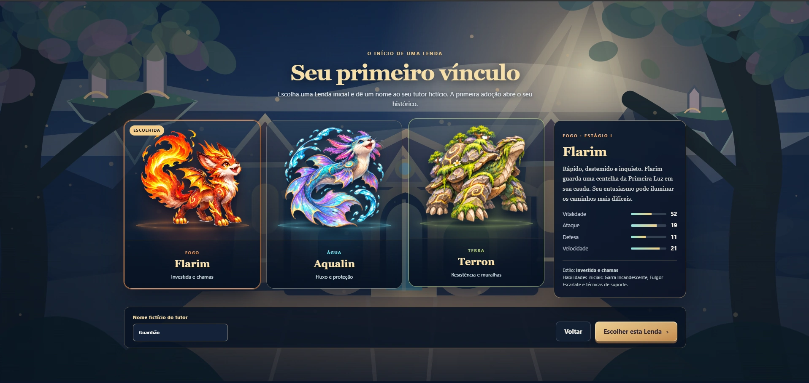

Os três cartões apresentam **Flarim** (Fogo, ataque e velocidade), **Aqualin** (Água, equilíbrio e suporte) e **Terron** (Terra, defesa e resistência). Ao selecionar um cartão, o painel à direita mostra a história, vitalidade, ataque, defesa, velocidade e habilidades da Lenda escolhida.

O botão **Escolher esta Lenda** pede confirmação e registra a primeira adoção com o nome fictício informado. O Guardião começa com a Lenda no **nível 5**, vínculo **35**, vida e energia completas e **250 moedas**. O primeiro cartão já fica disponível no Centro de Adoção.

### Observatório

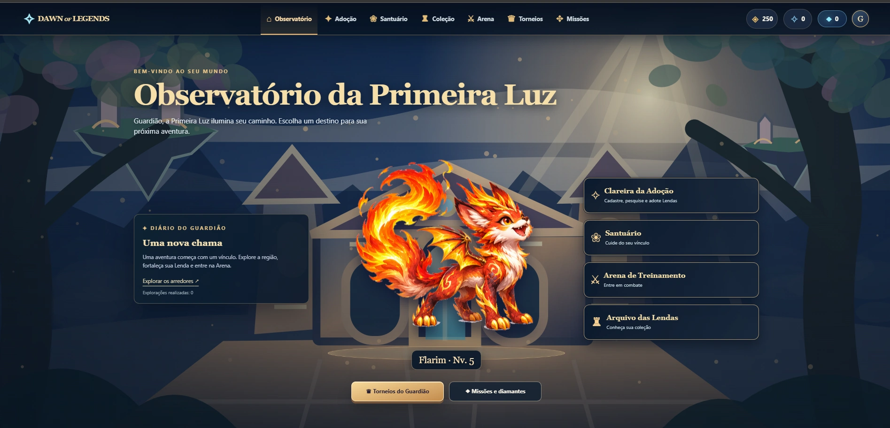

O Observatório é a página principal da jornada. Mostra o Guardião, a Lenda companheira e seu nível. Os atalhos levam ao Centro de Adoção, Santuário, Arena e Coleção, com botões adicionais para Torneios e Missões.

O **Diário do Guardião** acompanha as explorações e vitórias. **Explorar os arredores** tem um intervalo de seis segundos entre usos e rende **35 moedas**, com **1 fragmento de Luz** no lugar das moedas a cada terceira exploração. O menu superior mostra as áreas do site, os saldos e o botão circular que abre o perfil. O rodapé apresenta o estado do salvamento e o acesso às configurações.

### Centro de Adoção

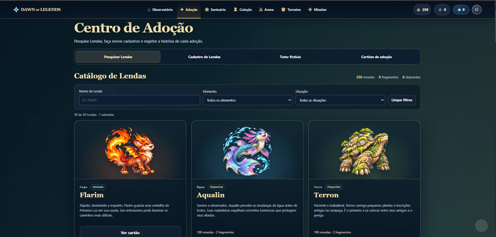

A captura mostra a aba **Pesquisar Lendas**. O campo de nome aceita partes do nome e ignora maiúsculas e acentos. Os filtros de elemento e situação podem ser combinados. **Limpar filtros** restaura a lista completa. Os cartões mostram a ilustração, a história, o elemento, a situação e, quando aplicável, o custo. Na imagem, Flarim já foi adotada e oferece **Ver cartão**. Aqualin e Terron ainda podem ser adotadas quando houver saldo suficiente.

| Aba | O que o Guardião pode fazer |
| --- | --- |
| **Pesquisar Lendas** | Consultar as 30 espécies originais e os registros locais, combinar filtros e abrir a confirmação de uma adoção. Os elementos disponíveis são Fogo, Água, Terra, Ar, Elétrico, Fada e Sombras. |
| **Cadastro de Lendas** | Cadastrar até 20 Lendas na jornada com nome de 2 a 32 caracteres, elemento e história de 10 a 280 caracteres. Os registros aparecem na lista de edição e na pesquisa. Nomes duplicados são rejeitados. |
| **Tutor fictício** | Cadastrar ou editar nome e origem dentro da história. O nome tem de 2 a 22 caracteres e a origem, de 2 a 40. Os dados entram nas próximas adoções. |
| **Cartões de adoção** | Consultar o histórico de adoções e baixar cada cartão em PNG. |

Use **Editar** para atualizar um cadastro local ou **Cancelar edição** para sair do formulário. A Lenda cadastrada herda a arte e os atributos do elemento e custa **50 moedas** para adotar. Depois de adotada, o nome e a história ainda podem ser editados, e o elemento fica fixo. As espécies originais fazem parte do catálogo do jogo. Seus custos variam e podem incluir moedas, fragmentos e diamantes.

#### Desafio Adoção com História

1. Na primeira jornada, o Guardião ganha um cadastro de tutor com o nome informado e origem inicial no **Observatório da Primeira Luz**. O cadastro pode ser completado ou atualizado na aba **Tutor fictício**.
2. Ao clicar em **Adotar Lenda**, o jogo apresenta o custo e a prévia de uma mensagem que combina tutor, local de origem, criatura e uma frase do elemento. O jogador pode escrever uma dedicatória de até 160 caracteres. **Cancelar** fecha a janela sem alterar o saldo.
3. Ao confirmar, o jogo confere o saldo e verifica se a espécie já está na coleção. A adoção desconta os recursos, adiciona a Lenda ao Arquivo no nível 5 e cria o cartão. A nova Lenda entra automaticamente na equipe quando existe uma vaga.
4. O cartão reúne nome da Lenda, tutor, origem, elemento, data, mensagem e dedicatória, quando preenchida. **Baixar cartão (PNG)** gera uma imagem do registro. Edições futuras no tutor ou na Lenda preservam o conteúdo do cartão já criado.
5. Jornadas antigas podem usar **Registrar adoção anterior** para criar um cartão de uma Lenda já adotada. O cartão mostra a data do registro e essa operação dispensa novo pagamento.

**Exemplo de mensagem**

> Lia da Aurora, de Vila das Marés, acolheu Brumavela. Que os ventos guiem a dupla para além do horizonte.

### Santuário

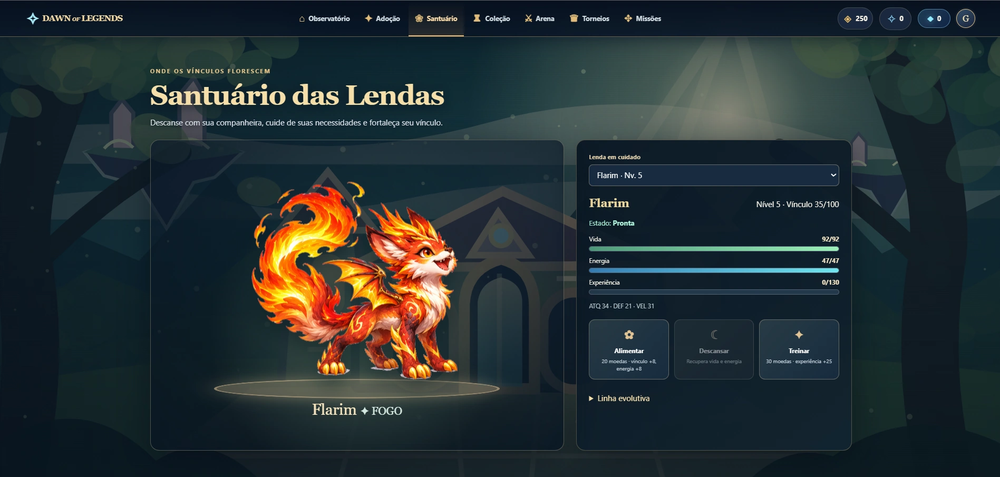

O seletor **Lenda em cuidado** alterna entre as criaturas adotadas. O painel exibe nível, vínculo, vida, energia, experiência, ataque, defesa e velocidade. Na captura, Flarim está **Pronta** porque tem **92/92 de vida** e **47/47 de energia**. O estado muda para **Precisa descansar** quando a vida ou a energia está abaixo do máximo e para **Debilitada** quando a vida chega a zero.

| Ação | Custo | Efeito |
| --- | --- | --- |
| **Alimentar** | 20 moedas | Aumenta o vínculo e recupera energia em até 8 pontos cada. |
| **Descansar** | Gratuito | Recupera toda a vida e a energia. Fica indisponível quando ambas estão completas. |
| **Treinar** | 30 moedas | Concede 25 pontos de experiência, recupera até 8 de energia e conta para a missão de treino. |

A seção **Linha evolutiva** pode ser aberta para comparar as formas **Inicial**, **Intermediária** e **Avançada**. As próximas formas são liberadas nos níveis **18** e **35** e exigem confirmação manual. A evolução muda a aparência e melhora os atributos e algumas habilidades. O nível máximo é **50**. As 30 espécies originais somam 90 formas, contando as iniciais.

### Coleção

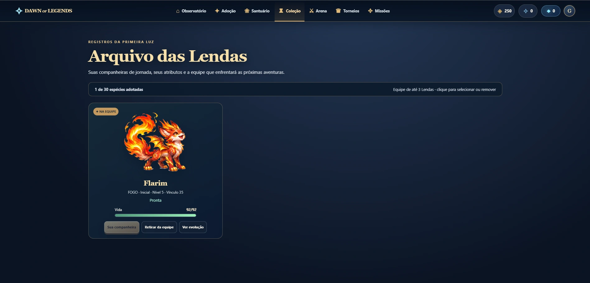

O **Arquivo das Lendas** reúne as espécies adotadas. Cada cartão mostra a forma atual, o elemento, o nível, o vínculo, o estado de cuidado e a barra de vida. O contador do alto compara a coleção com o total do catálogo da jornada.

- **Definir companheira** seleciona a Lenda exibida no Observatório e a inclui na equipe, se necessário. Com a equipe cheia, ela ocupa o primeiro lugar da formação.
- **Adicionar à equipe** ou **Retirar da equipe** altera a formação usada nas batalhas. A equipe comporta de uma a três Lendas. A retirada da equipe mantém a Lenda na coleção.
- **Ver evolução** abre a linha evolutiva da Lenda no Santuário.

### Arena

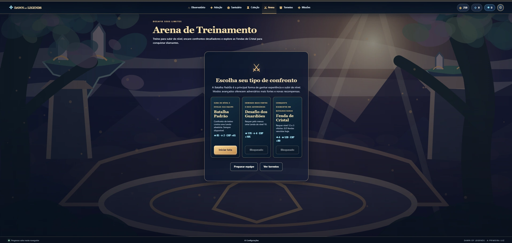

A captura mostra a seleção de confrontos. O botão **Preparar equipe** leva à Coleção, e **Ver torneios** abre o circuito. Ao iniciar uma luta, entram as Lendas da equipe com vida acima de zero. A **Batalha Padrão** já está liberada no início da jornada.

| Modalidade | Condição | Recompensa por vitória |
| --- | --- | --- |
| **Batalha Padrão** | Um adversário aleatório. Disponível desde o início. | 85 moedas, 2 fragmentos e 65 EXP |
| **Desafio dos Guardiões** | Uma Lenda da equipe no nível 10 ou superior. Dois adversários mais fortes. | 170 moedas, 4 fragmentos e 105 EXP |
| **Fenda de Cristal** | Uma Lenda da equipe no nível 12 ou superior e 3 vitórias registradas. Até 3 vitórias na Fenda por dia. | 120 moedas, 3 fragmentos, 4 diamantes e 80 EXP |

#### Durante o confronto

O painel mostra o número do turno, os combatentes, seus níveis, vida, energia e efeitos ativos. O jogador escolhe uma habilidade e, se o adversário continuar de pé, ele responde. Cada técnica mostra seu custo de energia e efeito. Ataques básicos sem custo recuperam energia. Entre as técnicas de suporte há cura, regeneração e escudos, conforme a espécie.

As afinidades mudam o dano. Água tem vantagem sobre Fogo, Elétrico sobre Água e Ar, e Terra sobre Elétrico. Algumas habilidades aplicam queimadura, veneno, lentidão ou paralisia. O adversário é controlado pelo jogo, que escolhe ações conforme os recursos e o estado do combate. Animações e o histórico mostram golpes, dano, cura e troca de combatentes.

**Trocar Lenda** consome a ação do turno. Se uma Lenda cair e houver outra disponível, a equipe pode continuar. **Retirar-se** conta como derrota e pede confirmação. Ao terminar, o jogo registra o resultado e salva os pontos de vida e energia resultantes. A vitória também concede experiência às Lendas que entraram no confronto.

Nesta versão, a proteção é aplicada pelas habilidades com escudo. O botão geral **Defender + recuperar energia** aparece na interface com a ação ainda pendente.

### Torneios

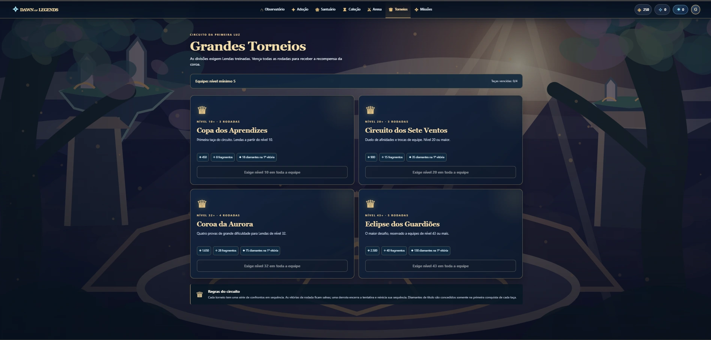

Os cartões mostram o nível exigido para **todos** os membros da equipe, o número de rodadas e os prêmios. A faixa acima deles mostra o menor nível da equipe, as taças vencidas e a sequência em andamento. Na captura, o menor nível é 5 e as inscrições estão bloqueadas.

| Taça | Nível mínimo | Rodadas | Prêmio da taça | Diamantes na primeira conquista |
| --- | ---: | ---: | --- | ---: |
| Copa dos Aprendizes | 10 | 3 | 450 moedas e 8 fragmentos | 18 |
| Circuito dos Sete Ventos | 20 | 3 | 1.000 moedas e 15 fragmentos | 35 |
| Coroa da Aurora | 32 | 4 | 1.650 moedas e 28 fragmentos | 75 |
| Eclipse dos Guardiões | 43 | 5 | 2.500 moedas e 40 fragmentos | 130 |

Use **Inscrever equipe** para iniciar uma taça e **Continuar sequência** após uma vitória de rodada. Só uma taça pode ficar em andamento por vez. As rodadas vencidas ficam salvas. Uma derrota ou retirada encerra a sequência e a tentativa seguinte começa na primeira rodada. É possível disputar uma taça novamente, com os diamantes de título concedidos na primeira conquista.

### Missões

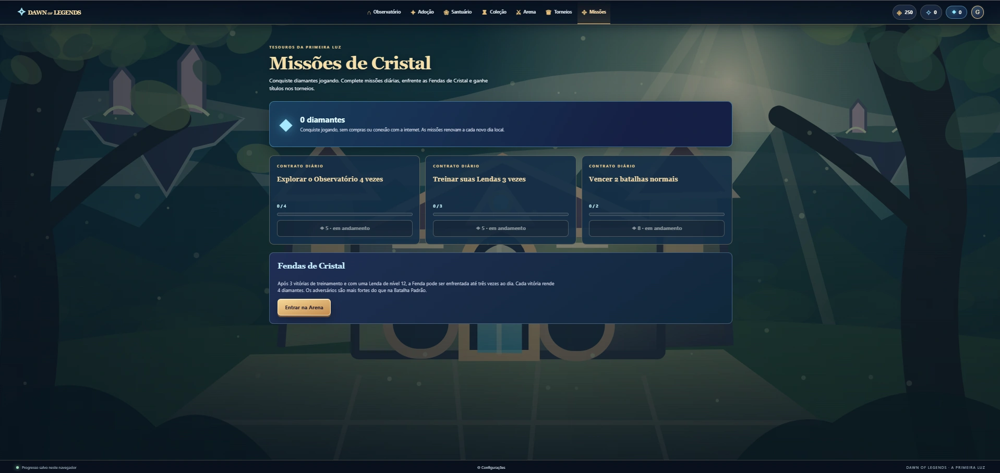

A tela exibe o saldo de diamantes e os objetivos do dia. Os cartões mostram a contagem atual, a meta e a recompensa. Quando a meta é atingida, o botão **Resgatar** é liberado. Cada recompensa pode ser resgatada uma vez por dia, e os objetivos são reiniciados conforme a data local do navegador.

| Missão diária | Recompensa |
| --- | ---: |
| Explorar o Observatório 4 vezes | 5 diamantes |
| Treinar Lendas 3 vezes no Santuário | 5 diamantes |
| Vencer 2 Batalhas Padrão | 8 diamantes |

A seção **Fendas de Cristal** apresenta o modo especial e oferece um atalho para a Arena. As Fendas e as primeiras conquistas de títulos nos torneios são outras fontes de diamantes dentro do jogo.

### Perfil

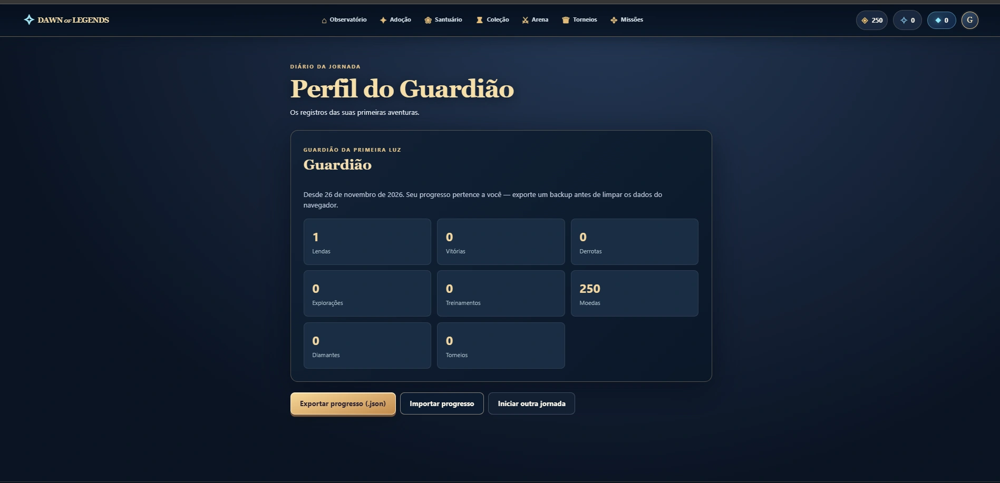

Clique no círculo com a inicial do nome, no canto superior direito, para abrir o **Perfil do Guardião**. A tela mostra a data de início da jornada, quantidade de Lendas, vitórias, derrotas, explorações, treinamentos, moedas, diamantes e torneios concluídos.

- **Exportar progresso (.json)** baixa uma cópia com coleção, equipe, cadastro de Lendas e tutor, cartões, recursos e contadores.
- **Importar progresso** valida o arquivo e pede confirmação antes de substituir a jornada atual. A importação também está disponível na tela inicial.
- **Iniciar outra jornada** pede confirmação antes de remover o progresso salvo e voltar à abertura. Exporte o JSON antes se quiser recuperar essa aventura depois.

### Acessibilidade

Abra **Acessibilidade** na tela inicial ou **Configurações** no rodapé durante a jornada.

- **Reduzir animações** diminui movimentos decorativos e simplifica as transições.
- **Alto contraste** reforça a distinção entre textos e bordas.
- Use **Tab** para navegar, **Enter** ou **Espaço** para ativar botões e **Esc** para fechar janelas de confirmação. Há um atalho para pular ao conteúdo e rótulos para campos e controles.
- Em telas estreitas, a navegação principal usa o botão **Menu**. No Centro de Adoção, os formulários, a lista de registros e os cartões se reorganizam conforme a largura.

## Esboço visual do Centro de Adoção

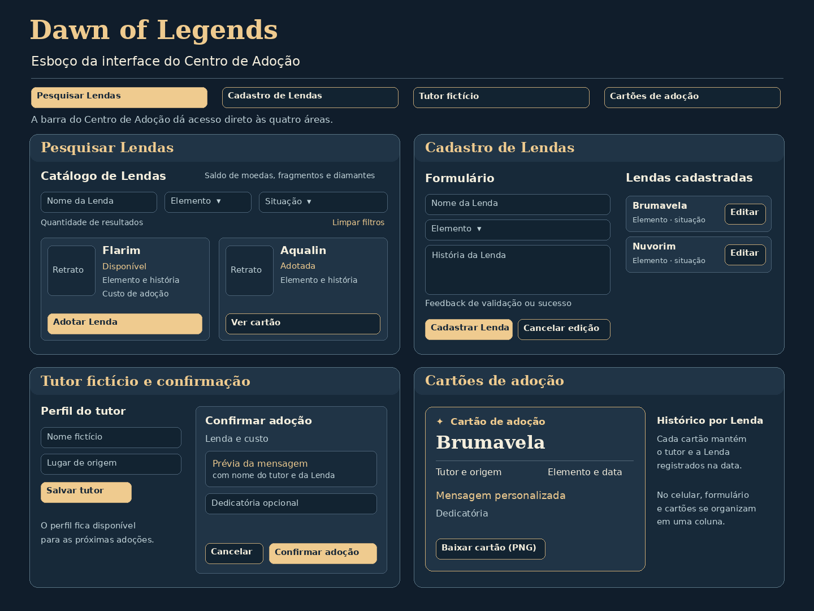

O esboço mostra como as quatro abas organizam a tarefa. A busca leva aos cartões do catálogo. A seleção de uma Lenda abre a confirmação com custo, prévia da mensagem e dedicatória. O formulário de tutor pode ser aberto durante o fluxo quando o cadastro estiver faltando. Após confirmar, o histórico é aberto no cartão gerado. A lista de cadastros permite reencontrar uma Lenda criada e editar seus dados.

## Objetos, arrays e salvamento

| Estrutura | Uso |
| --- | --- |
| `Lendas.species` | Objeto indexado pelo identificador da espécie, com dados como nome, elemento, história, atributos e habilidades. |
| `state.catalog` | Array dos registros locais. A edição altera os campos do objeto e preserva seu identificador. |
| `state.collection` | Array das Lendas adotadas com identificador, espécie, vida, energia, nível, experiência, forma e vínculo. |
| `state.team` e `state.selectedId` | Array de identificadores das Lendas da formação e identificador da companheira escolhida. |
| `state.tutor` e `state.adoptions` | Objeto do tutor atual e array de adoções. Cada registro conserva os dados usados para compor o cartão e o associa à Lenda da coleção. |
| `state.daily`, `state.tournament` e `state.stats` | Objetos com progresso diário, taças conquistadas, sequência em andamento e contadores gerais da jornada. |

A pesquisa combina os filtros com `filter()`. O cadastro e a adoção inserem objetos nos arrays com `push()`. A edição localiza o registro pelo identificador. A situação **Adotada** vem da presença da espécie na coleção, e o estado de cuidado resulta dos valores de vida e energia.

As alterações da jornada são salvas automaticamente em JSON no `localStorage` do navegador. Os turnos de um combate em andamento ficam na memória durante a partida. O resultado entra no progresso quando o confronto termina. Para recuperar a jornada em outro navegador ou outra pasta, use o backup em JSON exportado no perfil.

## Prioridades e demonstração

O fluxo principal da entrega reúne **cadastro e atualização**, **pesquisa**, **Adoção com História**, **cuidados** e **persistência**. Batalhas, torneios, missões e evolução complementam a jornada. O cadastro de Lendas por elemento reaproveita os recursos gráficos, e as moedas iniciais permitem demonstrar o fluxo principal sem combater.

1. Comece uma jornada, informe o tutor e confira o cartão da Lenda inicial.
2. Em **Adoção → Tutor fictício**, altere a origem para `Vila das Marés`.
3. Em **Cadastro de Lendas**, cadastre `Brumavela`, de elemento Ar, com a história `Seu canto guia os navegantes para casa quando a névoa cobre as montanhas.` Abra **Editar** e atualize a história.
4. Em **Pesquisar Lendas**, filtre por nome, elemento e situação **Disponíveis para adoção**. Adote a Lenda com uma dedicatória e baixe o cartão.
5. No **Santuário**, selecione Brumavela, alimente-a ou treine-a e confira a atualização do vínculo ou da experiência. Na **Coleção**, consulte a equipe.
6. Exporte o progresso no **Perfil**, reabra a página e confira a jornada salva. O backup JSON pode ser usado para restaurá-la.

## Organização do código

O jogo usa **HTML5**, **CSS3** e **JavaScript**. As telas fazem parte do mesmo HTML, e o JavaScript alterna entre elas, processa as ações e atualiza a interface. Os scripts, as artes e os cenários são carregados dos arquivos do projeto.

| Caminho | Responsabilidade |
| --- | --- |
| `index.html` | Estrutura e telas da página única. |
| `style.css` | Apresentação, adaptação a telas menores, estados visuais e animações. |
| `js/core.js` | Carregamento, salvamento e validação de dados, preferências, confirmação e feedback. |
| `js/lendas.js` | Catálogo, cadastro, regras de adoção e cuidado, atributos, habilidades, evolução e cálculo dos efeitos de combate. |
| `js/adocao.js` | Pesquisa, formulários, confirmação, histórico e geração dos cartões PNG. |
| `js/app.js` | Navegação, telas de jornada, batalhas, torneios e missões. |
| `assets/` | Artes, cenários e ilustrações locais do jogo. |
| `docs/` | Esboço da interface e capturas exibidas neste README. |

## Integrantes

- Ryan Martins Batista
- Renan dos Reis Batista
- Ana Clara de Souza Romanelli
